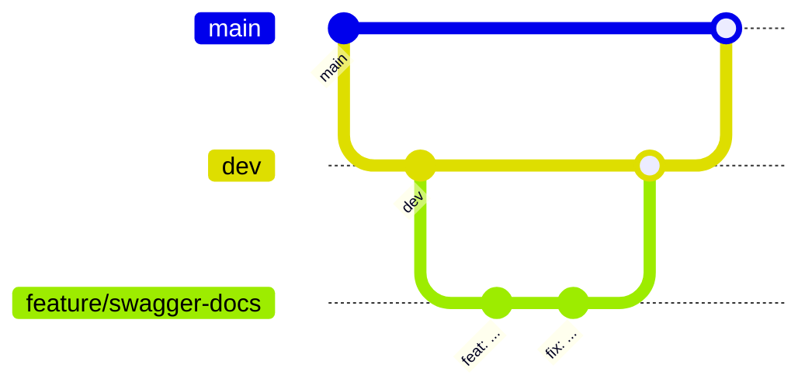

# Guía de contribución

Este documento reúne las convenciones de trabajo del equipo: cómo nombrar las ramas, cómo
escribir los mensajes de commit y cómo abrir un pull request.

## Flujo de trabajo

El repositorio usa dos ramas de larga duración:

| Rama | Propósito |
|------|-----------|
| `main` | Código estable, listo para desplegar. |
| `dev` | Integración de las funcionalidades en desarrollo. |

Cada cambio se hace en una rama propia creada a partir de `dev`:



1. Actualiza `dev` y crea tu rama:

   ```bash
   git checkout dev
   git pull
   git checkout -b feature/user-authentication
   ```

2. Haz commits pequeños con el formato descrito más abajo:

   ```bash
   git commit -m "feat: implement user registration API"
   ```

3. Sube la rama y abre un pull request hacia `dev`:

   ```bash
   git push -u origin feature/user-authentication
   ```

## Nombres de ramas

Los nombres deben ser descriptivos, en minúsculas y con guiones (`-`) para separar
palabras.

| Prefijo | Cuándo usarlo | Ejemplo |
|---------|---------------|---------|
| `feature/` | Nueva funcionalidad | `feature/user-authentication` |
| `bugfix/` | Corrección de un error | `bugfix/fix-api-routes` |
| `refactor/` | Mejora de estructura sin cambiar el comportamiento | `refactor/improve-database-queries` |

Reglas generales:

- Nombres cortos pero descriptivos.
- Guiones en lugar de espacios o guiones bajos.
- Un tema por rama.

## Mensajes de commit

Se sigue el estilo de [Conventional Commits](https://www.conventionalcommits.org/es/):

```text
<tipo>(<alcance opcional>): <descripción en imperativo>
```

| Tipo | Uso | Ejemplo |
|------|-----|---------|
| `feat` | Nueva funcionalidad | `feat: implement user registration API` |
| `fix` | Corrección de un error | `fix: correct validation on login endpoint` |
| `refactor` | Cambio de código que no agrega funcionalidad ni corrige errores | `refactor: restructure user service for better readability` |
| `docs` | Cambios en la documentación | `docs: add installation guide` |
| `style` | Formato, espacios, punto y coma; sin cambios de lógica | `style: format business controller` |
| `chore` | Tareas de mantenimiento, dependencias | `chore: update prisma to 5.22` |

El alcance entre paréntesis indica el módulo afectado, por ejemplo
`fix(business): ensure only one response is sent`.

## Pull requests

Al abrir un pull request se carga automáticamente la plantilla
[`.github/pull_request_template.md`](.github/pull_request_template.md). Completa:

- descripción del cambio y el issue relacionado;
- motivación y contexto;
- capturas de pantalla, si aplica;
- cómo se probó.

Antes de pedir revisión, comprueba al menos que el proyecto compila:

```bash
npx tsc --noEmit
```

## Documentación de la API

Cada endpoint nuevo debe documentarse con un bloque `@swagger` encima de su ruta, en
`src/routes/`. Swagger lee esos comentarios para construir `/api/docs`. Ejemplo:

```ts
/**
 * @swagger
 * /plans:
 *   get:
 *     summary: Obtener todos los planes
 *     tags: [Plans]
 *     responses:
 *       200:
 *         description: Lista de planes
 */
router.get('/', getAllPlans);
```

Si se agrega una etiqueta nueva (`tags`), regístrala también en `src/config/swagger.ts`.
