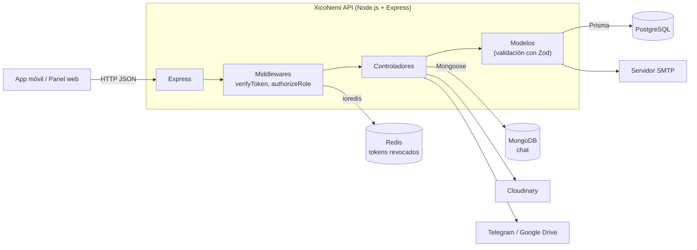

<h1 align="center">XicoNemi API</h1>

<p align="center">
  Backend de la aplicación turística XicoNemi: API REST con autenticación JWT, base de datos
  relacional, chat en tiempo real, carga de imágenes y respaldos automatizados.
</p>

<p align="center">
  &nbsp;&nbsp;
  &nbsp;&nbsp;
  <picture>
    <source media="(prefers-color-scheme: dark)" srcset="docs/img/logos/express-white.svg">
    
  </picture>&nbsp;&nbsp;
  <picture>
    <source media="(prefers-color-scheme: dark)" srcset="docs/img/logos/prisma-white.svg">
    
  </picture>&nbsp;&nbsp;
  &nbsp;&nbsp;
  &nbsp;&nbsp;
  &nbsp;&nbsp;
  
</p>

---

## Contenido

- [Descripción](#descripción)
- [Tecnologías](#tecnologías)
- [Arquitectura en resumen](#arquitectura-en-resumen)
- [Inicio rápido](#inicio-rápido)
- [Scripts disponibles](#scripts-disponibles)
- [Estructura del proyecto](#estructura-del-proyecto)
- [Recursos de la API](#recursos-de-la-api)
- [Documentación detallada](#documentación-detallada)
- [Contribuir](#contribuir)
- [Licencia](#licencia)

## Descripción

XicoNemi es una plataforma de turismo local. Este repositorio contiene su backend, que
ofrece a las aplicaciones cliente (móvil y panel web de administración) todo lo necesario
para:

- registrar usuarios e iniciar sesión con correo y contraseña, Google o Facebook;
- publicar y consultar **negocios**, **eventos**, **promociones**, **puntos de interés**,
  **rutas** e **itinerarios**;
- dejar **reseñas** con calificación y calcular el promedio por negocio;
- administrar **planes** de suscripción y obtener **estadísticas** para el panel;
- conversar mediante un **chat** que guarda los mensajes en MongoDB;
- subir **imágenes** a Cloudinary;
- generar **respaldos** de la base de datos y enviarlos a Telegram o Google Drive.

La documentación interactiva de la API (Swagger UI) se publica en `/api/docs`.

## Tecnologías

| | Tecnología | Uso en el proyecto |
|---|------------|--------------------|
|  | [Node.js](https://nodejs.org/) 20 | Entorno de ejecución |
|  | [TypeScript](https://www.typescriptlang.org/) 5 | Lenguaje, con tipado estricto (`strict: true`) |
| <picture><source media="(prefers-color-scheme: dark)" srcset="docs/img/logos/express-white.svg"></picture> | [Express](https://expressjs.com/) 4 | Servidor HTTP, rutas y middlewares |
| <picture><source media="(prefers-color-scheme: dark)" srcset="docs/img/logos/prisma-white.svg"></picture> | [Prisma](https://www.prisma.io/) 5 | ORM y esquema de la base de datos relacional |
|  | [PostgreSQL](https://www.postgresql.org/) | Base de datos principal |
|  | [MongoDB](https://www.mongodb.com/) + Mongoose | Historial de mensajes del chat |
|  | [Redis](https://redis.io/) + ioredis | Lista negra de tokens (cierre de sesión) |
| <picture><source media="(prefers-color-scheme: dark)" srcset="docs/img/logos/jsonwebtokens-white.svg"></picture> | [JSON Web Tokens](https://jwt.io/) | Autenticación sin estado |
|  | [Zod](https://zod.dev/) | Validación de los datos de entrada |
| <picture><source media="(prefers-color-scheme: dark)" srcset="docs/img/logos/socketdotio-white.svg"></picture> | [Socket.IO](https://socket.io/) | Mensajería en tiempo real |
|  | [Swagger](https://swagger.io/) (OpenAPI 3) | Documentación interactiva de la API |
|  | [Cloudinary](https://cloudinary.com/) | Almacenamiento de imágenes |
|  | [Telegram Bot API](https://core.telegram.org/bots/api) | Envío de respaldos |
|  | [Google Drive API](https://developers.google.com/drive) | Envío de respaldos |
|  | [Google Identity](https://developers.google.com/identity) | Inicio de sesión con Google |
|  | [Facebook Graph API](https://developers.facebook.com/docs/graph-api) | Inicio de sesión con Facebook |

Otras bibliotecas: `bcrypt` (hash de contraseñas), `nodemailer` y `handlebars` (correos),
`multer` (recepción de archivos), `morgan` (registro de peticiones), `cors`.

## Arquitectura en resumen



La explicación completa (capas, ciclo de vida de una petición, manejo de errores y tiempo
real) está en [docs/ARQUITECTURA.md](docs/ARQUITECTURA.md).

## Inicio rápido

Requisitos: Node.js 20 o superior, npm, y acceso a PostgreSQL, MongoDB y Redis. La guía
[docs/INSTALACION.md](docs/INSTALACION.md) explica cómo levantar estos servicios en local
con Docker.

```bash
# 1. Clonar e instalar dependencias (también genera el cliente de Prisma)
git clone https://github.com/LOctavioDev/backend-app.git
cd backend-app
npm install

# 2. Crear el archivo de configuración y completarlo
cp .env.example .env

# 3. Crear las tablas en PostgreSQL a partir del esquema
npx prisma db push

# 4. Iniciar en modo desarrollo
npm run dev
```

Con el servidor en marcha:

| URL | Contenido |
|-----|-----------|
| `http://localhost:<PORT>/` | Mensaje de bienvenida (`This is the API of the app`) |
| `http://localhost:<PORT>/api/...` | Endpoints de la API |
| `http://localhost:<PORT>/api/docs` | Swagger UI |

Si no se define `PORT`, el servidor usa el puerto `11111`. Las URL de Swagger están
configuradas para ese puerto, así que conviene usar `PORT=11111` en desarrollo.

Antes de arrancar, revisa la lista completa de variables en
[docs/VARIABLES_DE_ENTORNO.md](docs/VARIABLES_DE_ENTORNO.md): `.env.example` no incluye
todas las que usa el código.

## Scripts disponibles

| Comando | Qué hace |
|---------|----------|
| `npm run dev` | Inicia el servidor con `nodemon` y `ts-node`, y lo reinicia al detectar cambios. |
| `npm run build` | Compila TypeScript a `dist/` y copia las plantillas de correo. |
| `npm start` | Ejecuta la versión compilada (`dist/index.js`). Requiere `npm run build` antes. |
| `npm run seed` | Ejecuta `prisma/seed.ts`. Actualmente desactualizado respecto al esquema; ver [observaciones](docs/OBSERVACIONES.md). |
| `npm install` | Instala dependencias y ejecuta `prisma generate` (script `postinstall`). |

## Estructura del proyecto

```text
backend-app/
├── prisma/
│   ├── schema.prisma          Modelos, enums y relaciones de PostgreSQL
│   ├── seed.ts                Datos de ejemplo (desactualizado)
│   └── migrations/            Solo contiene migration_lock.toml
├── src/
│   ├── index.ts               Punto de entrada: crea el Server y lo inicia
│   ├── server.ts              Clase Server: Express, middlewares, rutas, Socket.IO
│   ├── config/                Conexiones: Prisma, MongoDB, Redis, Cloudinary, Swagger
│   ├── routes/                Definición de endpoints (y anotaciones de Swagger)
│   │   └── admin/             Rutas de respaldo
│   ├── middleware/            verifyToken, authorizeRole, errorHandler, lista negra
│   ├── controllers/           Leen la petición y arman la respuesta HTTP
│   │   ├── admin/             Autenticación de administradores y respaldos
│   │   └── common/            Inicio de sesión de usuarios comunes
│   ├── models/                Lógica de negocio, validación Zod y consultas Prisma
│   ├── services/              JWT, correo, respaldos, rate limit (desactivado)
│   │   └── emails/templates/  Plantillas HTML de correo (Handlebars)
│   ├── utils/                 AppError, bcrypt, logs con color, URLs
│   └── public/                Imágenes estáticas
├── docs/                      Documentación del proyecto
├── types.d.ts                 Extensión de tipos de Express
├── tsconfig.json
└── package.json
```

## Recursos de la API

Todas las rutas cuelgan del prefijo `/api`. La referencia completa, con métodos, permisos y
cuerpos de petición, está en [docs/API.md](docs/API.md).

| Recurso | Prefijo | Descripción |
|---------|---------|-------------|
| Autenticación | `/api/auth` | Registro, inicio de sesión (correo, Google, Facebook), cierre de sesión |
| Usuarios | `/api/users` | Perfil, administración de usuarios, verificación de correo |
| Negocios | `/api/businesses` | CRUD y listado público con calificación promedio |
| Eventos | `/api/events` | CRUD y eventos por negocio |
| Promociones | `/api/promotions` | CRUD |
| Ubicaciones | `/api/locations` | CRUD de direcciones y coordenadas |
| Puntos de interés | `/api/points` | CRUD |
| Rutas turísticas | `/api/routes` | Listado, detalle y creación |
| Itinerarios | `/api/itineraries` | CRUD |
| Reseñas | `/api/reviews` | CRUD y reseñas por negocio |
| Planes | `/api/plans` | CRUD de planes de suscripción |
| Estadísticas | `/api/stats` | Datos para gráficas del panel |
| Imágenes | `/api/images` | Carga a Cloudinary |
| Chat | `/api/chat` | Historial y envío de mensajes |
| Respaldos | `/api/backup` | Respaldo de PostgreSQL a Telegram o Google Drive |

## Documentación detallada

| Documento | Contenido |
|-----------|-----------|
| [Instalación](docs/INSTALACION.md) | Entorno local paso a paso, incluidos los servicios con Docker |
| [Variables de entorno](docs/VARIABLES_DE_ENTORNO.md) | Todas las variables que lee el código y para qué sirven |
| [Arquitectura](docs/ARQUITECTURA.md) | Capas, flujo de una petición, errores, tiempo real |
| [Base de datos](docs/BASE_DE_DATOS.md) | Diagrama entidad-relación, modelos y comandos de Prisma |
| [Referencia de la API](docs/API.md) | Todos los endpoints con permisos y ejemplos |
| [Autenticación](docs/AUTENTICACION.md) | JWT, roles, cierre de sesión, Google y Facebook |
| [Servicios externos](docs/SERVICIOS_EXTERNOS.md) | Cloudinary, correo, Telegram, Google Drive |
| [Observaciones técnicas](docs/OBSERVACIONES.md) | Detalles encontrados al revisar y ejecutar el proyecto |
| [Comandos de Prisma](prisma/readme.md) | Referencia rápida del CLI de Prisma |

## Contribuir

Las convenciones de ramas, commits y pull requests están en
[CONTRIBUTING.md](CONTRIBUTING.md). Para reportar vulnerabilidades, consulta
[SECURITY.md](SECURITY.md).

## Licencia

Distribuido bajo la licencia MIT. Consulta [LICENSE](LICENSE).

Los logotipos que aparecen en esta documentación pertenecen a sus respectivos dueños y se
usan únicamente para identificar cada tecnología. Los archivos provienen del proyecto
[Simple Icons](https://simpleicons.org/), que los toma de los recursos de marca oficiales,
con el color oficial de cada marca.
