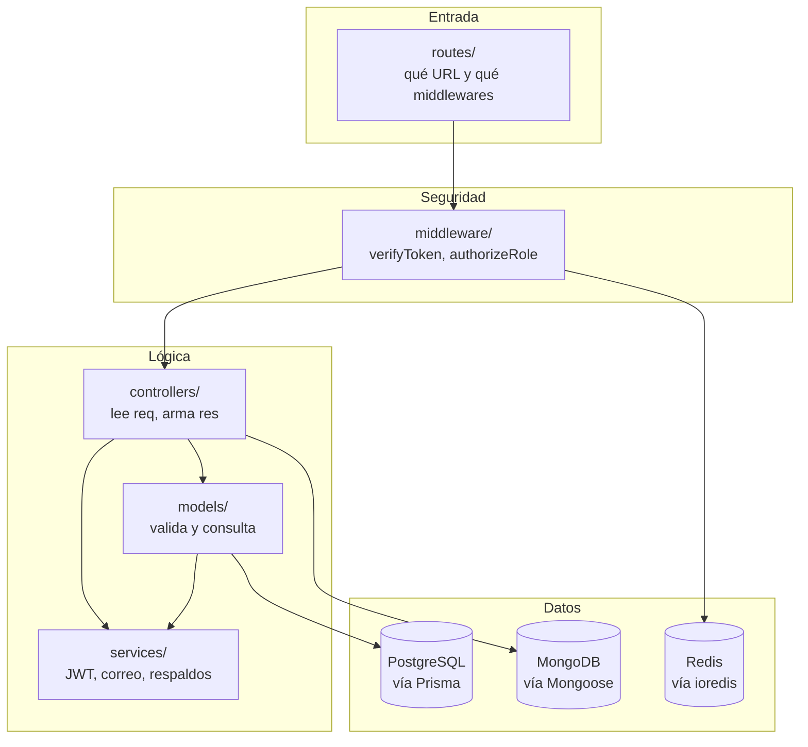
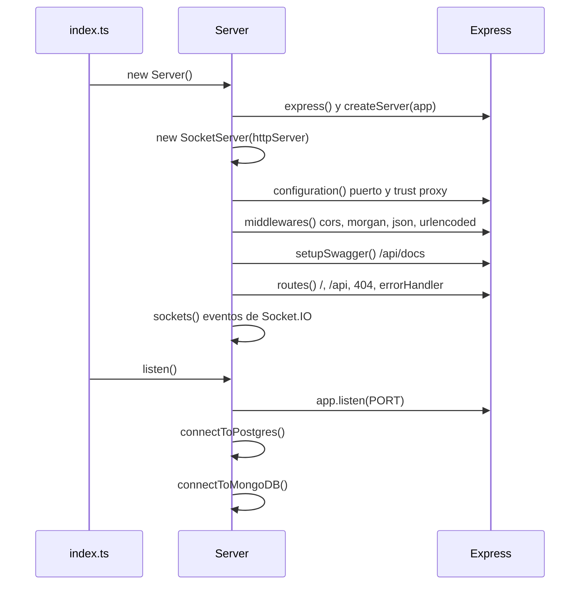
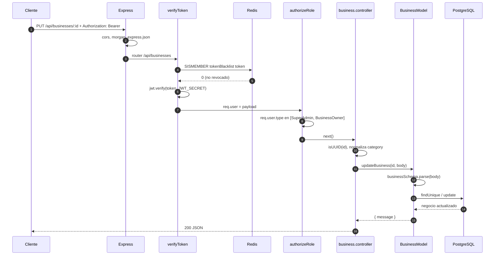

# Arquitectura

[Volver al README](../README.md)

Este documento explica cómo está organizado el código y qué recorrido hace una petición
desde que llega al servidor hasta que se responde. Sirve como guía para entender el
proyecto y para saber dónde agregar código nuevo.

## Contenido

- [Visión general](#visión-general)
- [Arranque del servidor](#arranque-del-servidor)
- [Capas del proyecto](#capas-del-proyecto)
- [Ciclo de vida de una petición](#ciclo-de-vida-de-una-petición)
- [Manejo de errores](#manejo-de-errores)
- [Validación de datos](#validación-de-datos)
- [Persistencia](#persistencia)
- [Tiempo real con Socket.IO](#tiempo-real-con-socketio)
- [Registro de peticiones](#registro-de-peticiones)
- [Cómo agregar un recurso nuevo](#cómo-agregar-un-recurso-nuevo)

## Visión general

El proyecto sigue una arquitectura en capas, inspirada en MVC pero sin vistas: la API solo
devuelve JSON.



| Capa | Carpeta | Responsabilidad | No debería |
|------|---------|-----------------|------------|
| Rutas | `src/routes` | Asociar método y URL con middlewares y controlador. Documentar con Swagger. | Contener lógica de negocio. |
| Middlewares | `src/middleware` | Autenticación, autorización, manejo de errores. | Consultar datos de negocio. |
| Controladores | `src/controllers` | Leer parámetros, llamar al modelo, elegir el código HTTP. | Hablar directamente con la base de datos. |
| Modelos | `src/models` | Validar con Zod, aplicar reglas de negocio, consultar con Prisma. | Conocer `req` o `res`. |
| Servicios | `src/services` | Integraciones: JWT, correo, Telegram, `pg_dump`. | Depender de Express. |
| Utilidades | `src/utils` | Funciones pequeñas y reutilizables. | Tener estado. |
| Configuración | `src/config` | Crear clientes de bases de datos y servicios externos. | |

## Arranque del servidor

`src/index.ts` solo crea una instancia de la clase `Server` y la pone a escuchar:

```ts
const server = new Server();
server.listen();
```

El constructor de `Server` (`src/server.ts`) prepara todo en un orden fijo:



Detalles:

- `configuration()` define el puerto (`PORT` o `11111`) y activa `trust proxy`, necesario
  cuando la API corre detrás de un proxy (Koyeb, Render) para obtener la IP real.
- Las conexiones a PostgreSQL y MongoDB se hacen **después** de empezar a escuchar. Si
  fallan, el servidor sigue en marcha y solo se registra el error.
- Redis no se conecta en `listen()`: el cliente se crea al importar
  `src/config/redisConfig.ts`, que ocurre cuando se cargan las rutas.

## Capas del proyecto

Un mismo recurso siempre sigue el patrón **ruta, controlador, modelo**. Ejemplo con
reseñas:

| Archivo | Fragmento |
|---------|-----------|
| `routes/review.routes.ts` | `router.put('/:id', verifyToken, updateReview);` |
| `controllers/review.controller.ts` | valida que `id` sea UUID, llama a `reviewModel.updateReview(id, req.body)` y responde `200` |
| `models/review.model.ts` | valida el cuerpo con `reviewSchema`, verifica que exista y ejecuta `prisma.reviews.update(...)` |

Los modelos son clases (`ReviewModel`, `UserModel`, etc.) y cada controlador crea una
instancia al cargarse:

```ts
const reviewModel = new ReviewModel();
```

## Ciclo de vida de una petición

Ejemplo: `PUT /api/businesses/:id` con un token de `BusinessOwner`.



Si cualquier paso falla, se llama a `next(error)` y la petición salta directamente al
manejador de errores.

## Manejo de errores

### La clase `AppError`

`src/utils/errorApp.ts` define un error con código HTTP y detalles opcionales:

```ts
throw new AppError('User not found', 404);
throw new AppError('Validation failed', 400, [{ field: 'email', message: '...' }]);
```

### El middleware `errorHandler`

`src/middleware/errorHandler.ts` es el último middleware registrado. Traduce cada tipo de
error a una respuesta JSON:

| Tipo de error | Código | Respuesta |
|---------------|--------|-----------|
| JSON mal formado en el cuerpo | 400 | `{ error: true, message: "Invalid JSON format..." }` |
| `AppError` | `err.status` | `{ error: true, message, details }` |
| `Prisma.PrismaClientKnownRequestError` | 400 | `{ error: true, message: "Prisma error: ...", code, meta }` |
| Cualquier otro | 500 | `{ error: true, message: "Internal server error" }` |

Las rutas inexistentes generan un `AppError('Route not found', 404)`:

```json
{ "error": true, "message": "Route not found", "details": null }
```

### Estilos de respuesta de error

No todos los módulos usan el mismo estilo. Conviene conocerlos al consumir la API:

| Estilo | Módulos | Ejemplo de respuesta |
|--------|---------|----------------------|
| Lanzan `AppError` y responden con el código adecuado | usuarios, autenticación, reseñas, planes, suscripciones, estadísticas | `400 { error: true, message: "Validation failed", details: [...] }` |
| Devuelven un objeto `{ message }` con código 200 | negocios, eventos, promociones, ubicaciones, puntos de interés, itinerarios, rutas | `200 { message: "Negocio no encontrado." }` |

En el segundo estilo, el cliente debe revisar el contenido de la respuesta, no solo el
código HTTP.

## Validación de datos

Cada modelo define un esquema de [Zod](https://zod.dev/) que describe el cuerpo esperado:

```ts
const planSchema = z.object({
  name: z.string().min(1, 'Campo requerido.'),
  price: z.number().min(1, 'Campo requerido.'),
  features: z.string().min(1, 'Campo requerido.'),
  status: z.boolean().default(false),
});
```

Los errores de Zod se convierten en una lista de `{ field, message }`:

```json
{
  "error": true,
  "message": "Validation failed",
  "details": [
    { "field": "price", "message": "Expected number, received string" }
  ]
}
```

Además, los controladores verifican con `uuid.validate()` que los parámetros `:id` sean UUID
válidos antes de consultar.

Importante: los modelos validan `req.body` con `schema.parse(data)`, pero después envían a
Prisma el objeto **original**, no el resultado de `parse`. Los campos que no están en el
esquema llegan igualmente a la base de datos. Ver [observaciones](OBSERVACIONES.md).

## Persistencia

| Almacén | Cliente | Qué guarda | Archivo de configuración |
|---------|---------|------------|--------------------------|
| PostgreSQL | Prisma | Todas las entidades del negocio | `src/config/sqlDataBase.ts` |
| MongoDB | Mongoose | Mensajes del chat (`Message`) | `src/config/nosqlDataBase.ts` |
| Redis | ioredis | Conjunto `tokenBlacklist` con los JWT revocados | `src/config/redisConfig.ts` |

El detalle de las tablas y relaciones está en [BASE_DE_DATOS.md](BASE_DE_DATOS.md).

Cada modelo crea su propio `new PrismaClient()`. Prisma recomienda una sola instancia
compartida (como la que exporta `src/config/sqlDataBase.ts`), porque cada instancia abre su
propio grupo de conexiones.

## Tiempo real con Socket.IO

`server.ts` configura un servidor de Socket.IO para el chat:

| Evento (cliente a servidor) | Datos | Efecto |
|-----------------------------|-------|--------|
| `joinRoom` | `{ userId, receiverId }` | Une al socket a la sala `idMenor-idMayor` |
| `sendMessage` | `{ senderId, receiverId, message }` | Guarda el mensaje en MongoDB y emite `receiveMessage` a la sala |
| `disconnect` | | Registra la desconexión |

| Evento (servidor a cliente) | Datos |
|-----------------------------|-------|
| `receiveMessage` | `{ senderId, message }` |

El nombre de la sala se forma ordenando los dos IDs, de modo que ambos participantes caen
en la misma sala sin importar quién la crea:

```ts
const roomId = [userId, receiverId].sort().join('-');
```

En el estado actual del código, el servidor de Socket.IO no recibe conexiones: se adjunta a
`httpServer`, pero `listen()` arranca un servidor distinto con `app.listen()`. El
diagnóstico y la corrección están en [observaciones](OBSERVACIONES.md).

## Registro de peticiones

`morgan` registra cada petición dos veces:

| Formato | Destino |
|---------|---------|
| `combined` (estilo Apache) | Archivo `logs/access.log` junto a `server.ts` (en desarrollo, `src/logs/`; compilado, `dist/logs/`) |
| `dev` (resumido, con colores) | Consola |

La carpeta de logs se crea automáticamente y está en `.gitignore`.

Los mensajes de arranque usan `loggerXiconemi(color, mensaje, tipo)` de
`src/utils/colorLogs.ts`, que imprime el texto entre dos líneas de `=` con el color del
tipo (`success`, `error`, `mysql`, `swagger`, etc.).

## Cómo agregar un recurso nuevo

Ejemplo: un recurso `Categorias`.

1. **Esquema:** agrega el modelo en `prisma/schema.prisma` y ejecuta
   `npx prisma db push` (o `npx prisma migrate dev --name add-categorias`).
2. **Modelo:** crea `src/models/categoria.model.ts` con un esquema Zod y una clase
   `CategoriaModel`. Importa el cliente compartido:
   `import prisma from '../config/sqlDataBase';`
3. **Controlador:** crea `src/controllers/categoria.controller.ts`. Cada función recibe
   `(req, res, next)`, llama al modelo y en caso de error ejecuta `next(error)`.
4. **Rutas:** crea `src/routes/categoria.routes.ts`, protege con `verifyToken` y
   `authorizeRole` donde corresponda, y documenta con bloques `@swagger`.
5. **Registro:** en `src/routes/index.ts` agrega `router.use('/categorias', categoriaRoutes);`.
   Sin este paso, las rutas no existen (es lo que pasa hoy con `subscriptions`).
6. **Swagger:** si usas una etiqueta nueva, agrégala en `src/config/swagger.ts`.
7. **Verificación:** `npx tsc --noEmit` y prueba en `/api/docs`.
