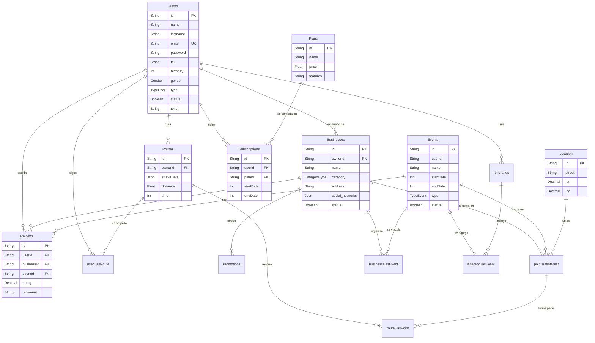

<p>
  &nbsp;&nbsp;
  <picture>
    <source media="(prefers-color-scheme: dark)" srcset="img/logos/prisma-white.svg">
    
  </picture>&nbsp;&nbsp;
  
</p>

# Base de datos

[Volver al README](../README.md)

El proyecto usa dos bases de datos:

| Base | Uso | Definición |
|------|-----|------------|
| PostgreSQL | Todas las entidades del negocio | `prisma/schema.prisma` |
| MongoDB | Historial del chat | `src/models/chat.model.ts` |

## Contenido

- [Diagrama entidad-relación](#diagrama-entidad-relación)
- [Convenciones del esquema](#convenciones-del-esquema)
- [Enumeraciones](#enumeraciones)
- [Tablas principales](#tablas-principales)
- [Tablas intermedias](#tablas-intermedias)
- [Colección de MongoDB](#colección-de-mongodb)
- [Comandos de Prisma](#comandos-de-prisma)

## Diagrama entidad-relación



## Convenciones del esquema

- **Identificadores:** todas las tablas usan `id String @id @default(uuid())`. Los
  endpoints validan que los parámetros `:id` tengan formato UUID.
- **Fechas:** se guardan como `Int` (marca de tiempo Unix **en segundos**). Una columna
  `Int` de PostgreSQL admite como máximo 2 147 483 647, así que un valor en milisegundos
  provoca un error. Esa capacidad alcanza hasta el año 2038.
- **Estado:** casi todas las tablas tienen `status Boolean`. Se usa como "activo" o
  "publicado". Eliminar un usuario no lo borra, solo pone `status = false`.
- **Borrado en cascada:** todas las relaciones usan `onDelete: Cascade`. Borrar un usuario
  físicamente borra sus negocios, y con ellos sus promociones, reseñas y eventos asociados.
- **Nombres:** las tablas principales están en plural y PascalCase (`Users`,
  `Businesses`). Las intermedias usan camelCase (`userHasRoute`). Prisma genera los
  accesores en minúscula inicial: `prisma.users`, `prisma.businesses`,
  `prisma.userHasRoute`.
- **Migraciones:** `prisma/migrations` solo contiene `migration_lock.toml`. Las tablas se
  crean con `npx prisma db push`.

## Enumeraciones

| Enum | Valores | Usado en |
|------|---------|----------|
| `TypeUser` | `Common`, `BusinessOwner`, `SuperAdmin` | `Users.type` (rol del usuario) |
| `Gender` | `Masculino`, `Femenino`, `Otro` | `Users.gender` |
| `CategoryType` | `Hospedaje`, `Gastronomia`, `Eventos`, `Turismo`, `Itinerarios`, `Cine`, `Otro` | `Businesses.category` |
| `TypeEvent` | `General`, `Cultural`, `Gastronomico`, `Aventura`, `Relax`, `Familiar`, `Otro` | `Events.type` |

Los valores distinguen mayúsculas y minúsculas. Al crear o editar un negocio, la API
normaliza `category` (primera letra en mayúscula y el resto en minúscula), así que
`gastronomia` se acepta como `Gastronomia`.

## Tablas principales

### Users

| Campo | Tipo | Notas |
|-------|------|-------|
| `id` | String (UUID) | Clave primaria |
| `name`, `lastname` | String | |
| `email` | String | Único |
| `password` | String | Hash bcrypt (10 rondas). Vacío en cuentas creadas con Facebook. |
| `tel` | String | |
| `birthday` | Int | Segundos Unix |
| `gender` | Gender? | |
| `url_image` | String? | URL de Cloudinary |
| `type` | TypeUser | Por defecto `Common` |
| `status` | Boolean | Por defecto `false`; indica cuenta activa |
| `token` | String? | Token de verificación de correo |
| `subscriptionId`, `facebookId` | String? | Actualmente sin uso en el código |

### Businesses

| Campo | Tipo | Notas |
|-------|------|-------|
| `ownerId` | String | FK a `Users` |
| `name`, `description`, `address`, `tel` | String | |
| `category` | CategoryType | |
| `url_image`, `web_site` | String? | |
| `social_networks` | Json? | Objeto `{ red: url }` |
| `status` | Boolean | Por defecto `false` |

### Events

| Campo | Tipo | Notas |
|-------|------|-------|
| `userId` | String | Sin relación declarada con `Users` |
| `name`, `description` | String | |
| `startDate`, `endDate` | Int | Segundos Unix |
| `type` | TypeEvent | Obligatorio en el esquema |
| `status` | Boolean | Por defecto `true` |

Un evento se vincula a un negocio mediante `businessHasEvent`, que se crea al llamar a
`POST /api/events` con `businessId`.

### Reviews

| Campo | Tipo | Notas |
|-------|------|-------|
| `userId` | String | FK a `Users` |
| `businessId`, `eventId` | String? | Una reseña puede ser de un negocio o de un evento |
| `rating` | Decimal(2,1) | De 0.0 a 9.9; en la práctica, de 1 a 5 |
| `comment` | String? | |

### Otras tablas

| Tabla | Campos principales | Descripción |
|-------|--------------------|-------------|
| `Promotions` | `businessId`, `name`, `description`, `status` | Promociones de un negocio |
| `Location` | `street`, `lat`, `lng` (Decimal) | Dirección con coordenadas |
| `pointsOfInterest` | `name`, `description`, `url_image`, `locationId`, `eventId?`, `businessId?` | Lugar en el mapa, asociado a una ubicación y opcionalmente a un evento o negocio |
| `Routes` | `ownerId?`, `name`, `description`, `stravaData` (Json), `distance`, `time` | Ruta turística; puede incluir datos exportados de Strava |
| `Itineraries` | `userId`, `name`, `startDate`, `endDate` | Plan de viaje de un usuario |
| `Plans` | `name`, `price`, `features` | Planes de suscripción |
| `Subscriptions` | `userId`, `planId`, `startDate`, `endDate` | Contratación de un plan |

## Tablas intermedias

Representan relaciones muchos a muchos. Todas tienen su propio `id` y un `status`.

| Tabla | Relaciona |
|-------|-----------|
| `businessHasEvent` | Negocios y eventos |
| `itineraryHasEvent` | Itinerarios y eventos |
| `userHasRoute` | Usuarios y rutas que siguen |
| `routeHasPoint` | Rutas y puntos de interés que recorren |

## Colección de MongoDB

`src/models/chat.model.ts` define el modelo `Message` (colección `messages`):

| Campo | Tipo | Notas |
|-------|------|-------|
| `senderId` | Number | Requerido |
| `receiverId` | Number | Requerido |
| `message` | String | Requerido |
| `timestamp` | Date | Por defecto, la fecha actual |

Los IDs de usuario son UUID (texto), pero este esquema los declara como `Number`. Al
intentar guardar un mensaje con IDs reales, Mongoose no puede convertirlos y la operación
falla. Ver [observaciones](OBSERVACIONES.md).

## Comandos de Prisma

Los comandos de uso frecuente están en [prisma/readme.md](../prisma/readme.md). Los más
importantes para este proyecto:

```bash
npx prisma generate   # regenerar el cliente tras cambiar schema.prisma
npx prisma db push    # sincronizar el esquema con la base de datos
npx prisma studio     # explorar y editar datos en el navegador
```
