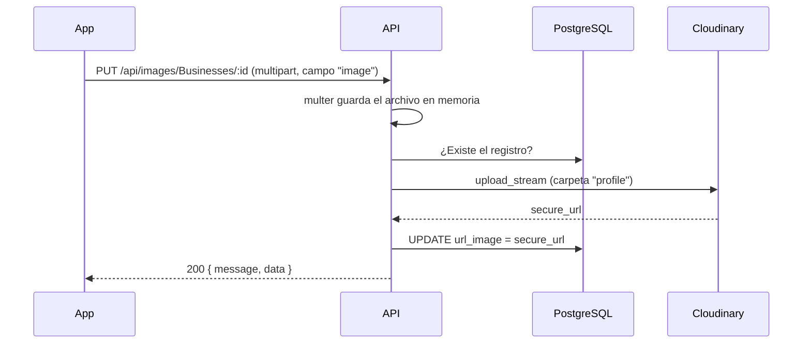
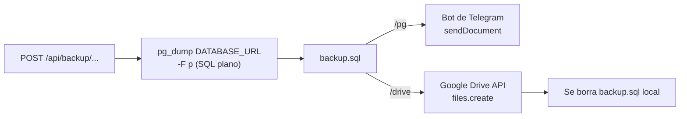

# Servicios externos

[Volver al README](../README.md)

Además de sus bases de datos, la API se integra con varios servicios de terceros. Cada uno
se activa con sus propias variables de entorno (ver
[VARIABLES_DE_ENTORNO.md](VARIABLES_DE_ENTORNO.md)). Si una integración no está
configurada, el resto de la API sigue funcionando.

## Contenido

- [Cloudinary: imágenes](#cloudinary-imágenes)
- [Correo](#correo)
- [Respaldos](#respaldos)
- [Google y Facebook](#google-y-facebook)
- [Swagger](#swagger)
- [Limitación de peticiones (desactivada)](#limitación-de-peticiones-desactivada)

---

## Cloudinary: imágenes


Cloudinary almacena las imágenes y devuelve una URL pública con HTTPS.

| Elemento | Archivo |
|----------|---------|
| Configuración del cliente | `src/config/cloudinary.ts` |
| Endpoint de carga | `PUT /api/images/:tableName/:id` |
| Lógica | `src/controllers/image.controller.ts` |



- El archivo no se escribe en disco: `multer.memoryStorage()` lo mantiene en memoria y se
  envía a Cloudinary como un *stream*.
- Tablas admitidas: `Users`, `Businesses`, `Events`, `pointsOfInterest`, `Routes`.
- Todas las imágenes se guardan en la carpeta `profile` de Cloudinary, sin importar la
  tabla.
- No se limita el tamaño ni el tipo de archivo.

Variables: `CLOUD_NAME`, `API_KEY`, `API_SECRET`.

---

## Correo

El correo de bienvenida se envía al registrarse un usuario.

| Elemento | Archivo |
|----------|---------|
| Transporte SMTP | `src/services/emailService.ts` (Nodemailer) |
| Plantilla | `src/services/emails/templates/newAccount.html` (Handlebars) |

**Funcionamiento:**

1. `loadTemplate('newAccount', datos)` lee el HTML y lo compila con Handlebars.
2. Variables de la plantilla:
   - `{{name}}`: nombre del usuario (escapado automáticamente).
   - `{{{verificationUrl}}}`: enlace del botón. Las tres llaves indican que **no** se
     escape, para que la URL llegue intacta.
3. Nodemailer envía el mensaje desde `support@xiconemi.com` con el asunto
   `Verify your email`.

**Plantillas en producción:** `tsc` solo compila archivos `.ts`. Por eso el script
`npm run build` copia la carpeta `templates` a `dist/` después de compilar. Si se agrega
una plantilla nueva, no hace falta hacer nada más.

**Pruebas en local:** usa [Mailpit](https://mailpit.axllent.org/) como servidor SMTP falso
(ver [INSTALACION.md](INSTALACION.md#servidor-de-correo-de-pruebas-mailpit)). Si el
servidor SMTP no responde, el proceso termina; ver [observaciones](OBSERVACIONES.md).

**Gmail:** con `EMAIL_HOST=smtp.gmail.com` y `EMAIL_PORT=587`, la contraseña debe ser una
[contraseña de aplicación](https://support.google.com/accounts/answer/185833), con la
verificación en dos pasos activada.

Variables: `EMAIL_HOST`, `EMAIL_PORT`, `EMAIL_USER`, `EMAIL_PASS`.

---

## Respaldos

<p>
  &nbsp;&nbsp;
  &nbsp;&nbsp;
  
</p>

Dos endpoints, solo para `SuperAdmin`, generan un volcado SQL de PostgreSQL con `pg_dump`
y lo envían a un destino externo.

| Endpoint | Destino | Archivos |
|----------|---------|----------|
| `POST /api/backup/pg` | Chat de Telegram | `services/backupService.ts`, `controllers/admin/backupController.ts` |
| `POST /api/backup/drive` | Carpeta de Google Drive | `controllers/admin/backupController.ts` |



**Requisitos comunes:**

- `pg_dump` instalado en el servidor y con versión igual o superior a la de PostgreSQL.
  Muchas plataformas de despliegue no lo incluyen por defecto.
- El archivo se llama `backup.sql`. Con `/pg` se genera en la raíz del proyecto y se
  conserva. Con `/drive` se genera en `src/` (o en `dist/` con la versión compilada) y se
  borra después de subirlo. `.gitignore` excluye `*.sql`.

### Telegram

1. Crea un bot con [@BotFather](https://t.me/BotFather) y copia su token en `BOT_TOKEN`.
2. Agrega el bot al chat o canal destino y obtén su ID para `CHAT_ID`.
3. El bot se crea sin *polling*: solo envía, no escucha mensajes.

Si el envío a Telegram falla, el error se registra en consola, pero el endpoint responde
igualmente `200 Backup generado y enviado correctamente`.

### Google Drive

1. Crea una **cuenta de servicio** en Google Cloud y descarga su clave JSON.
2. Habilita la Google Drive API en el proyecto.
3. Guarda el JSON completo en una línea en `GOOGLE_SERVICE_ACCOUNT_JSON`.
4. Comparte la carpeta destino con el correo de la cuenta de servicio y copia el ID de la
   carpeta (la parte final de su URL) en `FOLDER_ID`.

El archivo se sube como `backup_<fecha ISO>.sql` con el permiso
`https://www.googleapis.com/auth/drive.file`, que solo da acceso a los archivos creados por
la propia aplicación.

---

## Google y Facebook

<p>
  &nbsp;&nbsp;
  
</p>

| Proveedor | Biblioteca | Qué se verifica | Variable |
|-----------|------------|-----------------|----------|
| Google | `google-auth-library` (`OAuth2Client.verifyIdToken`) | Firma del `idToken` y que su `audience` sea `GOOGLE_CLIENT` | `GOOGLE_CLIENT` |
| Facebook | `axios` contra `graph.facebook.com/me` | Que el `accessToken` permita leer `id`, `name` y `email` | Ninguna |

Los flujos completos están en [AUTENTICACION.md](AUTENTICACION.md).

---

## Swagger


`src/config/swagger.ts` usa `swagger-jsdoc` para construir una especificación OpenAPI 3.0 a
partir de los comentarios `@swagger` de `src/routes/**/*.ts`, y `swagger-ui-express` para
publicarla en `/api/docs`.

- Define dos servidores: local (`http://localhost:11111/api`) y producción. En Swagger UI
  se elige cuál usar en el selector **Servers**.
- Declara el esquema de seguridad `BearerAuth`. Con el botón **Authorize** se pega el token
  una vez y se envía en todas las pruebas.
- Las URL están en `src/utils/urlVerification.ts`.

Cobertura actual: 46 de las 73 operaciones. Faltan imágenes, itinerarios, puntos de
interés, promociones, rutas, planes y chat. La referencia completa está en
[API.md](API.md).

---

## Limitación de peticiones (desactivada)

`src/services/rateLimitService.ts` contiene, comentado, un limitador basado en
`express-rate-limit` con almacenamiento en Redis (`rate-limit-redis`): 15 peticiones cada
15 minutos por IP, pensado para el inicio de sesión. No está activo en ninguna ruta.

Para activarlo habría que descomentar el archivo y aplicarlo en la ruta:

```ts
import signInLimiter from '../services/rateLimitService';
router.post('/sign-in', signInLimiter, signIn);
```

La opción `trust proxy` ya está activada en `server.ts`, requisito para que el limitador
identifique la IP real detrás de un proxy.
